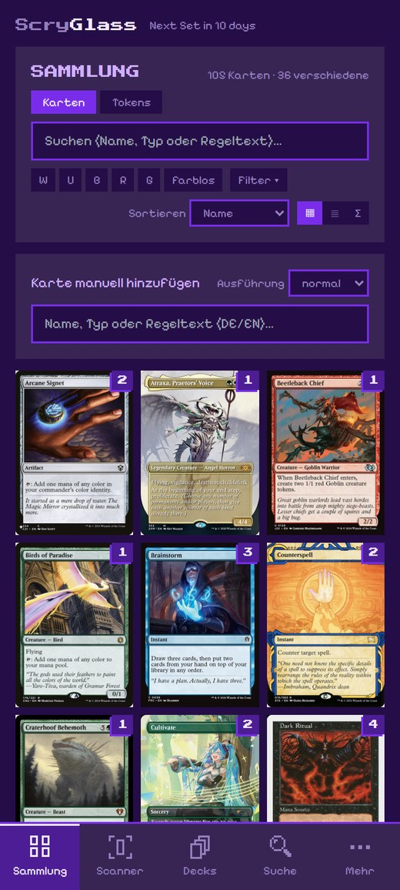
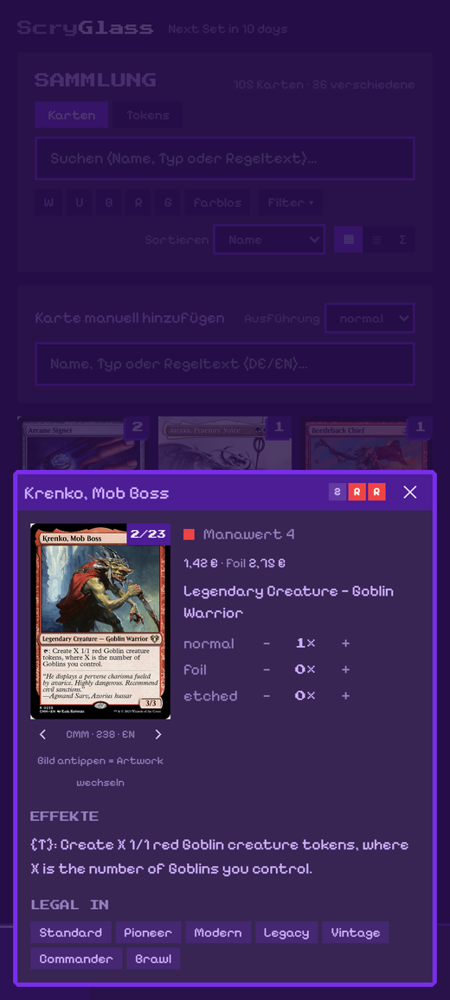
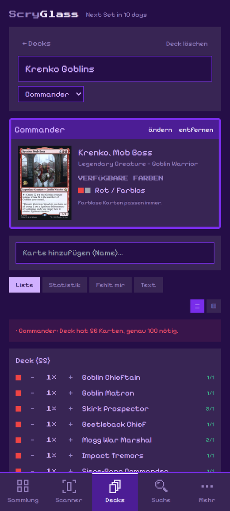
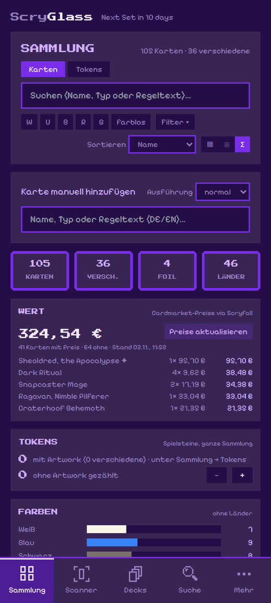
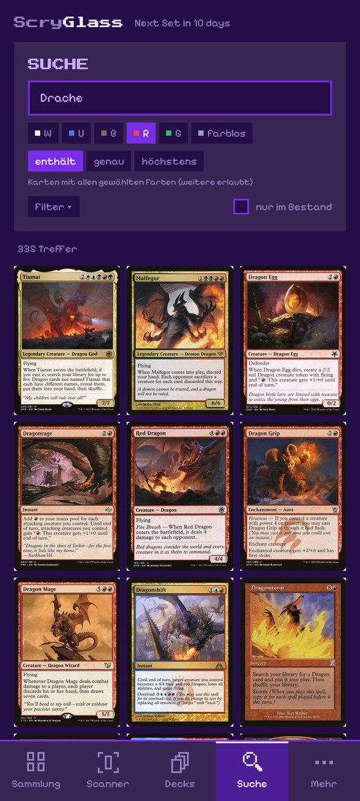
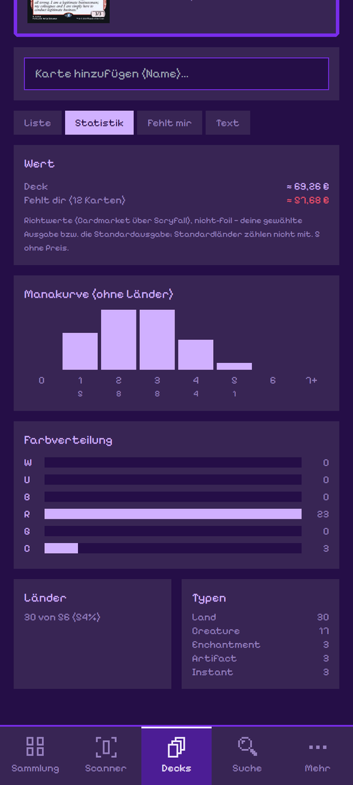
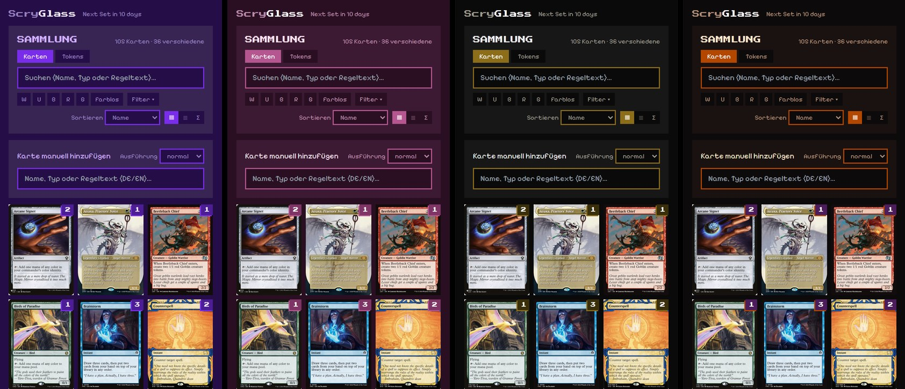

# ScryGlass

**Scan, organize and build decks with your Magic: The Gathering cards, right on your
phone, even without internet.**

ScryGlass is a free, fan-made Android app. Point your camera at a card and it lands in
your collection. Browse what you own, look up any card ever printed, see what your
collection is worth and build decks from it. Everything stays on your phone: no
account, no cloud, no ads.

  
  
  

> **Download:** grab `ScryGlass-x.y.z.apk` from the
> [latest release](https://github.com/LordCookie/ScryGlass/releases/latest) (see
> [Installation](#installation)). The app's interface is in **German**; card search
> understands German and English card names.

---

## How it works

### 1. Scan your cards

Open the **Scanner** tab and hold a card in front of the camera. ScryGlass recognizes it
in two ways at once: it **reads the card name** and **compares the artwork** against
every printing. When both agree, the card is added right away; if it is unsure, it
asks you to pick.

- **Pile mode** (*Auto-Korb*): put down one card after another, and each new card is
  recognized and counted on its own.
- **Set mode:** opening boosters or sorting one set? Limit the search to that set for
  faster, more reliable matches.
- Works with showcase and borderless frames, tokens and emblems.
- Sound and vibration on every hit, flashlight, tap to focus, landscape mode, and an
  undo history for mistakes.
- Recognition runs entirely on the phone, so no photo ever leaves your device.

### 2. Your collection

The **Sammlung** (collection) tab shows everything you own as a card grid or a list.
Filter by color, card type, mana value, set or finish, and sort by name, mana value,
quantity or value. Tokens get their own tab and are counted per artwork.

Tap a card to see its rules text, the formats it is legal in and its current price.
Browse all printings to choose the artwork you actually own, and count normal, foil
and etched copies separately (see the screenshots at the top).

  

The **Σ** view sums it all up: total cards, foils, lands, the **collection value**
(Cardmarket prices via Scryfall) with your most valuable cards, color and type
breakdowns, mana curve and how far along you are with each set.

### 3. Search every card

The **Suche** (search) tab covers the complete catalog of about 34,000 cards and
1,000 tokens, stored on your phone. Search by name, type or rules text in German or
English. *Drache* finds dragons just like *dragon* does. Filter by colors (contains,
exactly, at most), card type, mana value and format, or show only cards you own.

  

### 4. Build decks

The **Decks** tab builds decks from your collection for Standard, Pioneer, Modern,
Legacy, Vintage, Commander, Pauper and Brawl.

- Live rule checks: deck size, copy limits, format legality and, for Commander, your
  commander's color identity.
- Every card shows how many you own against how many the deck needs.
- Statistics: mana curve, color distribution, card types, land ratio.
- **Deck value**, plus a **"Fehlt mir"** (missing) list that says what you still need
  and roughly what it costs.
- **Deck check:** an estimate of the Commander bracket with the cards that cause it, land
  count and color sources, ramp/card advantage/removal/board wipes, and combos in the deck,
  including the ones you are one card away from that are already in your collection.
- Import and export as text (Moxfield format).

  
  

### 5. Scan together

Sorting a big box? Several phones on the same Wi-Fi can scan at once. Helpers pair with
your phone by QR code and send their scans over. You review everything before it goes
into your collection. No internet or server needed.

### 6. Pick your look

A pixel-art design with four color schemes: violet, sunset, black & gold and
Halloween. The header counts down the days to the next Magic set.

  

---

## Installation

ScryGlass is not in the Play Store; you install it directly from GitHub.

1. On your phone, open the
   [latest release](https://github.com/LordCookie/ScryGlass/releases/latest) and
   download `ScryGlass-x.y.z.apk`.
2. Open the downloaded file. Android asks whether your browser may install apps:
   allow it once, then tap **Install**.
3. On first start the card catalog is set up once, which takes about a minute. After
   that everything works offline.

**Updates come through the app:** under **Mehr → App-Update** (more → app update)
ScryGlass checks GitHub for a new version. Before installing, it backs up your
collection and verifies the download's checksum and signature. New sets arrive as a
weekly **catalog update** (**Mehr → Katalog**), no new app needed.

*Requirements:* Android 5.1 or newer (updates from inside the app need Android 7), and a
camera for scanning.

> Updating from **0.2.6 or 0.2.7**? Those versions can't update themselves. Install
> 0.2.8 or newer once by hand as described above. Your collection is kept.

---

## Your data

- Your collection, decks and settings live **only on your phone**. There is no account
  and no tracking.
- Make backups under **Mehr → Backup & Export**. *In Dokumente sichern* saves a file to
  `Documents/ScryGlass` that survives uninstalling the app; *Backup teilen* sends it to
  Google Drive, mail or wherever you like. ScryGlass also backs up automatically before
  every update and import, and reminds you if your last backup is a month old.
- **Switching from ManaBox?** Export your collection there as CSV and import it under
  **Mehr → Backup & Export → CSV importieren**. Moxfield and most other CSV exports work
  too. You see what was recognized before anything is added. The CSV export goes the
  other way and is readable by ManaBox and Moxfield.
- The internet is used only for card images and prices (from Scryfall), the
  next-set countdown and updates (from GitHub). Without a connection everything else
  keeps working.

---

## For developers

The app is built with React, TypeScript and Capacitor, plus native Android plugins for
the camera and on-device text recognition. The card catalog comes from a Python
pipeline that runs weekly on GitHub Actions. Architecture, project structure and build
steps are in [DEVELOPMENT.md](DEVELOPMENT.md); the full plan is in [PLAN.md](PLAN.md)
and the design system in [DESIGN.md](DESIGN.md). These documents are in German.

---

## Legal

- **Unofficial fan project.** ScryGlass is unofficial Fan Content permitted under the
  [Wizards of the Coast Fan Content Policy](https://company.wizards.com/en/legal/fancontentpolicy).
  It is not approved or endorsed by Wizards of the Coast or Scryfall. Portions of the
  materials used are property of Wizards of the Coast. ©Wizards of the Coast LLC.
- **Free, forever.** No ads, no in-app purchases, no donations, no sales.
- **Card data and images** come from [Scryfall](https://scryfall.com). The app ships no
  card images; it loads them from Scryfall when they are shown and caches them on the
  phone. The card images in the screenshots above are © Wizards of the Coast. Prices
  are rough guidance only.
- **Combo data** comes from [Commander Spellbook](https://commanderspellbook.com), card
  roles from the community tags of [Scryfall Tagger](https://tagger.scryfall.com). The
  star ratings for combos are ScryGlass's own.
- Source code under the [MIT License](LICENSE).
